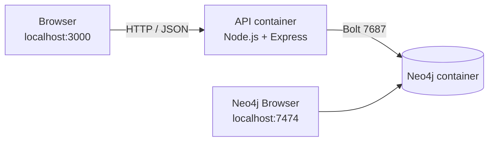

# Resource Sharing System

> A campus resource-sharing platform (notes, lab manuals, books) built with **Node.js**, **Express** and the **Neo4j graph database**, fully containerised with **Docker**.


This project is a NoSQL re-implementation of an Oracle SQL / PL-SQL "Resource Sharing System" (DBMS course assignment). Students can share digital and physical study resources, borrow and return physical items (with automatic late fines), rate resources, mark favourites and report problems.

---


## Table of Contents

1. [Features](#features)
2. [Tech Stack](#tech-stack)
3. [Project Structure](#project-structure)
4. [Prerequisites](#prerequisites)
5. [Getting Started](#getting-started)
6. [Using the Application](#using-the-application)
7. [Running the API Without Docker](#running-the-api-without-docker)
8. [Configuration](#configuration)
9. [REST API Reference](#rest-api-reference)
10. [Data Model](#data-model)
11. [From SQL to Neo4j](#from-sql-to-neo4j)
12. [Cypher Script for the Project Report](#cypher-script-for-the-project-report)
13. [Why Neo4j?](#why-neo4j)
14. [Troubleshooting](#troubleshooting)
15. [Viva Cheat Sheet](#viva-cheat-sheet)

---


## Features

- **Resource catalogue:** browse and filter by type (digital / physical), status (available / borrowed), subject or search text.
- **Borrow and return:** physical resources can be borrowed for 7 days. Returning late adds a fine of **Rs. 10 per late day**. Both operations are single ACID transactions.
- **Business rules enforced:** digital resources cannot be borrowed, a borrowed item cannot be borrowed again, ratings must be 1-5 and unique per user and resource.
- **Ratings, favourites, reports:** rate resources, manage a favourites list, report a resource and resolve or reject reports.
- **Download counter** for digital resources.
- **Live dashboard** with node / relationship counts and average ratings straight from Neo4j.
- **Sample data** is loaded automatically on first start.
- **Neo4j Browser** included for visualising the graph.


## Tech Stack


| Layer          | Technology                                                              |
| -------------- | ----------------------------------------------------------------------- |
| Database       | Neo4j 5 Community (graph database, queried with Cypher)                 |
| Backend        | Node.js 20, Express 4, `neo4j-driver` 5                                 |
| Frontend       | Single-page HTML/JS app served by the API (`backend/public/index.html`) |
| Infrastructure | Docker and Docker Compose                                               |





## Project Structure

```
9_4_Resource-Sharing/
├── docker-compose.yml               # Neo4j + API containers
├── backend/
│   ├── Dockerfile
│   ├── package.json                 # express + neo4j-driver
│   ├── public/index.html            # frontend (served by the API)
│   └── src/
│       ├── server.js                # REST API: business logic, validation, transactions
│       ├── db.js                    # driver, read/write/transaction helpers, constraints
│       ├── seed.js                  # sample data
│       └── util.js                  # HttpError + password hashing
├── cypher/resource_sharing.cypher   # the full SQL document redone in Cypher
└── scripts/smoke-test.sh            # curl-based end-to-end API test
```

---


## Prerequisites

Install the following **before** running any command in this project.


| Tool               | Required?                                                          | Why                    | Download                                                                                           |
| ------------------ | ------------------------------------------------------------------ | ---------------------- | -------------------------------------------------------------------------------------------------- |
| **Git**            | Yes                                                                | Clone the repository   | [https://git-scm.com/downloads](https://git-scm.com/downloads)                                     |
| **Docker Desktop** | Yes                                                                | Runs Neo4j and the API | [https://www.docker.com/products/docker-desktop/](https://www.docker.com/products/docker-desktop/) |
| **Node.js 20+**    | Only for [running without Docker](#running-the-api-without-docker) | Run the API directly   | [https://nodejs.org/](https://nodejs.org/)                                                         |
| **Postman**        | Optional                                                           | Try the API manually   | [https://www.postman.com/downloads/](https://www.postman.com/downloads/)                           |


**Windows users:** Docker Desktop needs WSL 2. The installer enables it for you; if it asks, follow Microsoft's guide: [https://learn.microsoft.com/windows/wsl/install](https://learn.microsoft.com/windows/wsl/install). Restart the PC afterwards if prompted.

**Check your installation** (all three commands should print a version):

```bash
git --version
docker --version
docker compose version
```

> **Important:** open Docker Desktop and wait until it says **"Engine running"** before continuing.

**Free ports:** `3000` (web app and API), `7474` (Neo4j Browser) and `7687` (Bolt). See [Troubleshooting](#troubleshooting) if any of them is in use.

---


## Getting Started


### 1. Clone the repository

```bash
git clone https://github.com/ParthanahalliRehaan/9_4_Resource-Sharing.git
cd 9_4_Resource-Sharing
```


### 2. Start the project

```bash
docker compose up --build
```

The first run downloads the Neo4j and Node images and installs dependencies, so it needs an internet connection and takes a few minutes. Later runs start in about a minute.

### 3. Wait for the ready message

Look for this line in the terminal:

```
Resource Sharing System running on http://localhost:3000
```

While Neo4j is booting you may see `Waiting for Neo4j (n/30)...`. That is normal. The sample data is loaded automatically the first time.

### 4. Open the app


| URL                                                                  | Purpose                                                    |
| -------------------------------------------------------------------- | ---------------------------------------------------------- |
| [http://localhost:3000](http://localhost:3000)                       | **Web application** (use this for demos)                   |
| [http://localhost:3000/api/health](http://localhost:3000/api/health) | Backend health check                                       |
| [http://localhost:7474](http://localhost:7474)                       | **Neo4j Browser** (graph visualisation and Cypher console) |


**Neo4j Browser login:** connect URL `bolt://localhost:7687`, username `neo4j`, password `resource123`.

> These credentials are for local development only. Change `NEO4J_AUTH` and `NEO4J_PASSWORD` in `docker-compose.yml` before deploying anywhere public.


### 5. (Optional) Verify with the smoke test

In a **second terminal**, from the project folder:

```bash
bash scripts/smoke-test.sh
```

It exercises health, borrow, return with fine, rating rules, favourites and reports. On Windows run it from **Git Bash** (installed with Git). Needs `curl`.

### Stopping and resetting


| Goal                                | Command                                                         |
| ----------------------------------- | --------------------------------------------------------------- |
| Stop (keep data)                    | `Ctrl + C`, then `docker compose down`                          |
| Stop and **wipe all data**          | `docker compose down -v`                                        |
| Start again later                   | `docker compose up`                                             |
| Rebuild after changing backend code | `docker compose up --build`                                     |
| Run in the background               | `docker compose up -d --build` (logs: `docker compose logs -f`) |


---


## Using the Application

The frontend has these tabs: **Dashboard**, **Resources**, **Borrow / Return**, **Favorites**, **Reports** and **Departments · Subjects · Users** (add master data). Use the **Acting as** dropdown to switch between the sample users. A black **Last API call** panel at the bottom shows each request and response.

**Sample users:** Rahul (1), Priya (2), Arjun (3), Sneha (4).

### Suggested 5-minute demo

1. **Dashboard:** node and relationship counts and average ratings come from Neo4j.
2. **Resources:** filter *physical* + *available*. Choose **Acting as: Priya** and click **Borrow** on "Operating Systems Book". The status becomes *borrowed*.
3. Click **Borrow** again as Rahul. Error: *"Resource is not available"*. Try borrowing a digital resource: *"Only physical resources can be borrowed"*.
4. **Borrow / Return:** pick a return date 12 days ahead and click **Return**. The fine is **Rs. 120** and the resource is available again.
5. **Resources:** **Rate** with 6 is rejected (1-5 rule). Rate with 4 is saved. Rating again is rejected (duplicate).
6. **Favorites:** remove one (DELETE). **Reports:** resolve the pending report (UPDATE).
7. Open **Neo4j Browser** and run the query below to see the whole graph:
  ```cypher
   MATCH p=(n)-[]->(m) WHERE NOT n:Counter AND NOT m:Counter RETURN p
  ```

---


## Running the API Without Docker

Only Neo4j runs in Docker; the API runs on your machine (requires Node.js 20+).

```bash
# Terminal 1: start only the database
docker compose up neo4j

# Terminal 2: start the API
cd backend
npm install
npm start
```

The API uses the defaults in [Configuration](#configuration), which match the Docker setup.

---


## Configuration

Environment variables read by the API (defaults work out of the box):


| Variable         | Default                                                     | Description          |
| ---------------- | ----------------------------------------------------------- | -------------------- |
| `NEO4J_URI`      | `bolt://localhost:7687` (`bolt://neo4j:7687` inside Docker) | Neo4j connection URL |
| `NEO4J_USER`     | `neo4j`                                                     | Neo4j username       |
| `NEO4J_PASSWORD` | `resource123`                                               | Neo4j password       |
| `PORT`           | `3000`                                                      | API / web port       |


---


## REST API Reference

Base URL: `http://localhost:3000`. All request and response bodies are JSON.


| Method and path                                                    | Description                                                   |
| ------------------------------------------------------------------ | ------------------------------------------------------------- |
| `GET /api/health`                                                  | Health check                                                  |
| `GET /api/stats`                                                   | Node and relationship counts                                  |
| `POST /api/reset`                                                  | Reload sample data                                            |
| `GET` / `POST /api/departments`                                    | List / add department                                         |
| `GET` / `POST /api/subjects`                                       | List (with department) / add subject                          |
| `GET` / `POST /api/users`                                          | List (no passwords) / register (hashed password)              |
| `GET /api/resources?type=&status=&subject_id=&q=`                  | List / filter resources (with subject and owner)              |
| `POST /api/resources`                                              | Add resource (`owner_id`, `subject_id`, `resource_type`, ...) |
| `POST /api/resources/:id/download`                                 | Increment download count (digital only)                       |
| `POST /api/borrow` `{user_id, resource_id}`                        | Borrow a resource (due in 7 days)                             |
| `POST /api/return` `{borrow_id, resource_condition, return_date?}` | Return and calculate fine                                     |
| `GET /api/borrows`                                                 | List borrow records                                           |
| `GET` / `POST /api/ratings`                                        | List / rate (1-5, once per user and resource)                 |
| `GET /api/ratings/average`                                         | Average rating per resource                                   |
| `GET` / `POST /api/favorites`, `DELETE /api/favorites/:id`         | List / add / remove favourite                                 |
| `GET` / `POST /api/reports`, `PATCH /api/reports/:id` `{status}`   | List / report / resolve or reject                             |


**Example:**

```bash
curl -X POST http://localhost:3000/api/borrow \
  -H 'Content-Type: application/json' \
  -d '{"user_id":2,"resource_id":1003}'
```

On Windows PowerShell use `curl.exe` with escaped quotes, or use Postman.

**Status codes:** `400` validation error, `404` referenced record not found, `409` conflict (already borrowed / duplicate), `422` rule violation (digital resource cannot be borrowed).

---


## Data Model

Tables became **node labels** and foreign keys became **relationships**:

```
(User)-[:MEMBER_OF]->(Department)<-[:IN_DEPARTMENT]-(Subject)<-[:BELONGS_TO]-(Resource)<-[:OWNS]-(User)
(User)-[:BORROWED]->(Borrow)-[:FOR_RESOURCE]->(Resource)
(Borrow)-[:HAS_RETURN]->(ReturnLog)
(User)-[:RATED {rating_id, rating_value, review, rating_date}]->(Resource)
(User)-[:FAVORITED {favorite_id, added_date}]->(Resource)
(User)-[:REPORTED]->(Report {report_id, reason, status, report_date})-[:ABOUT]->(Resource)
```


| SQL table                             | Neo4j                                                  | Reason                                                                                                                       |
| ------------------------------------- | ------------------------------------------------------ | ---------------------------------------------------------------------------------------------------------------------------- |
| department, subject, users, resources | Nodes `Department`, `Subject`, `User`, `Resource`      | Normal entities                                                                                                              |
| borrow, return_log                    | Nodes `Borrow`, `ReturnLog`                            | Own id, status and lifecycle                                                                                                 |
| rating, favorite                      | **Relationships** `RATED`, `FAVORITED` with properties | A rating or favourite *is* a link between user and resource; one edge per pair gives the `UNIQUE(user_id, resource_id)` rule |
| report                                | Node `Report` plus relationships                       | Multiple reports allowed; status is updated                                                                                  |


## From SQL to Neo4j


| In the SQL / PL-SQL document                                           | In this project                                                                                            |
| ---------------------------------------------------------------------- | ---------------------------------------------------------------------------------------------------------- |
| `PRIMARY KEY`, `UNIQUE`                                                | Neo4j uniqueness constraints (`db.js`, section 1 of the `.cypher` file)                                    |
| `NOT NULL`, `CHECK` (semester 1-8, year 1-4, rating 1-5, type, status) | Validation functions in `server.js` (`toInt`, `toStr`, `oneOf`); Community edition has no CHECK / NOT NULL |
| `FOREIGN KEY`                                                          | Relationship created in the same query that `MATCH`es the referenced node; otherwise the API returns 404   |
| `DEFAULT sysdate`                                                      | `date()` in Cypher                                                                                         |
| Sequences `borrow_seq`, `return_seq`                                   | `Counter` nodes incremented atomically in the creating query                                               |
| `JOIN`                                                                 | `MATCH (a)-[:REL]->(b)`                                                                                    |
| Procedure `borrow_resource`                                            | `POST /api/borrow` (one ACID transaction)                                                                  |
| Procedure `return_resource` and function `calculate_fine`              | `POST /api/return` (one ACID transaction, Rs. 10 per late day)                                             |
| Cursor (average rating per resource)                                   | Aggregation query `GET /api/ratings/average`                                                               |
| Trigger `trg_resource_date`                                            | `date()` set when the resource node is created                                                             |
| Trigger `trg_check_borrow`                                             | Checks inside the borrow transaction (digital: 422, already borrowed: 409)                                 |
| `COMMIT` / `ROLLBACK`                                                  | Transaction commits when the function returns, rolls back if it throws                                     |
| `user_tables`, `user_objects`                                          | `SHOW CONSTRAINTS`, `SHOW INDEXES`, `CALL db.labels()`                                                     |


> Neo4j Community has no native triggers. The APOC plugin offers `apoc.trigger.install(...)` if real triggers are required; the in-transaction checks do the same job and are easier to explain.

**Concurrency:** before borrowing, the transaction writes to the resource node (`lock_version`), which takes a lock. Two users borrowing at the same moment are serialised, so one gets "Resource is not available" instead of both succeeding.

---


## Cypher Script for the Project Report

`cypher/resource_sharing.cypher` follows the numbering of the SQL project document (sections 1-10).

1. Open Neo4j Browser at [http://localhost:7474](http://localhost:7474) and log in.
2. Paste each statement (or block), run it and screenshot the result for the **OUTPUT** part.
3. For the PL/SQL-equivalent sections (6-8) also show the API call (Postman, curl or the frontend's "Last API call" panel).

> **Warning:** section 0 (`MATCH (n) DETACH DELETE n`) wipes the database. Skip it if you want to keep your data.

---


## Why Neo4j?

The data has 9 entities that are almost all connected by foreign keys, plus multi-step logic (borrow / return / fine) that must be all-or-nothing. That calls for a database that models relationships natively and supports real transactions.


| Database           | Type                 | Fit                                                                                                                                                                          |
| ------------------ | -------------------- | ---------------------------------------------------------------------------------------------------------------------------------------------------------------------------- |
| **Neo4j (chosen)** | Graph                | Foreign keys become relationships, a "join" is following an edge, **ACID transactions**, unique constraints, built-in visual browser, large community, official Docker image |
| ArangoDB           | Document + graph     | Good fit, but smaller community and fewer learning resources                                                                                                                 |
| Cassandra          | Wide-column          | Poor fit: no joins, no real transactions, one table per query                                                                                                                |
| CouchDB            | Document             | No joins, no multi-document transactions                                                                                                                                     |
| Redis              | Key-value            | Possible, but all joins and aggregates would be hand-written                                                                                                                 |
| DynamoDB (local)   | Key-value / document | Needs single-table design tricks; hard to explain                                                                                                                            |


---


## Troubleshooting


| Problem                                                                   | Fix                                                                                                                     |
| ------------------------------------------------------------------------- | ----------------------------------------------------------------------------------------------------------------------- |
| `docker: command not found` or "cannot connect to the Docker daemon"      | Start Docker Desktop and wait for "Engine running".                                                                     |
| Port `3000`, `7474` or `7687` already in use                              | Stop the other program, or change the **left** number of the port mapping in `docker-compose.yml` (e.g. `"3001:3000"`). |
| API logs "Waiting for Neo4j (n/30)..."                                    | Normal on first start. The API retries for about 60 seconds.                                                            |
| `Unauthorized` / `AuthenticationRateLimit`                                | Neo4j stores the password in its volume the first time it starts. Run `docker compose down -v` and start again.         |
| Changed backend code but nothing changed                                  | `docker compose up --build`                                                                                             |
| Want a clean database                                                     | Click **Reset demo data** in the app, or `docker compose down -v`.                                                      |
| `bash scripts/smoke-test.sh` fails with `\r: command not found` (Windows) | Git converted line endings. Run `sed -i 's/\r$//' scripts/smoke-test.sh` in Git Bash, then retry.                       |
| `docker compose` not recognised                                           | Update Docker Desktop, or try the older `docker-compose` command.                                                       |


---


## Viva Cheat Sheet

**Short answer to "Why NoSQL?":** *"Our data is highly connected (users, resources, subjects, departments, borrows, ratings, favourites, reports) and we need ACID transactions for borrow and return, so we chose the Neo4j graph database. It is NoSQL, queried with Cypher."*


| Question                                            | Answer                                                                                                   |
| --------------------------------------------------- | -------------------------------------------------------------------------------------------------------- |
| Why NoSQL / why graph?                              | Highly connected data; relationships are first-class so joins are cheap; flexible schema.                |
| Where are the foreign keys?                         | Relationships. The API creates them only when both nodes exist.                                          |
| How do you stop two people borrowing the same book? | One transaction plus a write lock on the resource node.                                                  |
| How are sequences done?                             | `Counter` nodes incremented atomically in the same transaction as the insert.                            |
| Are passwords safe?                                 | Salted scrypt hashes (the SQL document used plain text).                                                 |
| What are the limitations?                           | No CHECK constraints or native triggers in Community edition, so they are enforced in the service layer. |


